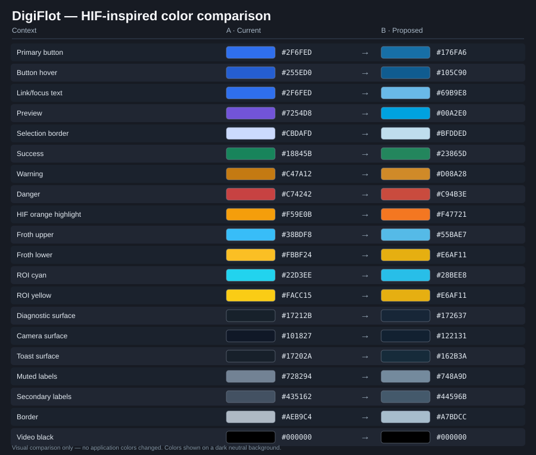

# DigiFlot Edge — Color Palette

**Status:** Applied in the `main` branch on 2026-11-14. This is the current palette reference.
**Canonical CSS:** [`src/ui/css/common.css`](src/ui/css/common.css)  
**Historical A → B audit:** [`HIF_COLOR_AUDIT_AND_MIGRATION.md`](src/docs/HIF_COLOR_AUDIT_AND_MIGRATION.md)

The palette preserves the existing dark UI and brings its blue and orange accents closer to HIF/Helmholtz identity. The historic Helmholtz design guide documents `#00589C`, `#003E6E`, `#00A2E0` and `#E6AF11`; HIF orange `#F47721` is an approximate logo-inspired value, not a verified official 2026 HIF color specification.

## Visual overview



| Context | Cor A · anterior | → | Cor B · aplicada | CSS / uso |
|---|---|:---:|---|---|
| Azul principal / CTA |  `#2F6FED` | → |  `#176FA6` | `--action-background (dark)` |
| Hover de CTA |  `#255ED0` | → |  `#105C90` | `--action-hover (dark)` |
| Texto de link e foco |  `#2F6FED` | → |  `#69B9E8` | `--interactive-text (dark)` |
| Preview / câmera |  `#7254D8` | → |  `#00A2E0` | `--preview` |
| Passed / sucesso |  `#18845B` | → |  `#23865D` | `--success` |
| Alerta / skipped |  `#C47A12` | → |  `#D08A28` | `--warning` |
| Erro / abort |  `#C74242` | → |  `#C94B3E` | `--danger` |
| Realce laranja |  `#F59E0B` | → |  `#F47721` | `--hif-orange` |
| Interface superior |  `#0EA5E9` | → |  `#29AEE4` | `--plot-froth-upper` |
| Referência / linha azul |  `#38BDF8` | → |  `#55BAE7` | `--plot-froth` |
| Interface inferior |  `#FBBF24` | → |  `#E6AF11` | `--plot-pulp-secondary` |
| Seleção de ROI |  `#22D3EE` | → |  `#28BEE8` | `--roi-cyan` |
| ROI em edição |  `#FACC15` | → |  `#E6AF11` | `--roi-yellow` |
| Plano de câmera |  `#17212B` | → |  `#172637` | `background de diagnóstico` |
| Área de imagem |  `#101827` | → |  `#122131` | `background de mídia` |
| Toast |  `#17202A` | → |  `#162B3A` | `fundo de feedback` |
| Texto secundário |  `#435162` | → |  `#44596B` | `em superfícies claras` |
| Texto discreto |  `#728294` | → |  `#748A9D` | `em superfícies claras` |
| Bordas neutras |  `#AEB9C4` | → |  `#A7BDCC` | `em superfícies claras` |
| Fundo do vídeo |  `#000000` | → |  `#000000` | `preservado` |

## Current palette and semantic tokens

| Context | Current swatch / HEX | Token | Primary use |
|---|---|---|---|
| HIF blue |  `#00589C` | `--hif-blue` | Referência histórica Helmholtz; botões no tema claro |
| HIF dark blue |  `#003E6E` | `--hif-dark-blue` | Hover no tema claro |
| HIF light blue |  `#00A2E0` | `--hif-light-blue / --preview` | Preview e identificação de câmera |
| HIF orange |  `#F47721` | `--hif-orange / --plot-pulp` | Realces e curva inferior |
| Energy yellow |  `#E6AF11` | `--hif-energy-yellow / --plot-pulp-secondary` | Limites e marcações físicas |
| Action blue (dark) |  `#176FA6` | `--action-background` | Botões preenchidos |
| Action hover (dark) |  `#105C90` | `--action-hover` | Hover de botão preenchido |
| Interactive text (dark) |  `#69B9E8` | `--interactive-text` | Links, foco, títulos selecionados |
| Success background |  `#23865D` | `--success` | Indicadores e cores sólidas |
| Success text (dark) |  `#5FC796` | `--success-text` | Textos pequenos de estado |
| Warning background |  `#D08A28` | `--warning` | Alertas e avisos |
| Warning text (dark) |  `#F1BE69` | `--warning-text` | Textos pequenos de estado |
| Danger background |  `#C94B3E` | `--danger` | Abort e erros |
| Danger text (dark) |  `#F28A7C` | `--danger-text` | Textos pequenos de erro |
| Froth selected line |  `#55BAE7` | `--plot-froth` | Overlay sobre imagem |
| Froth upper curve |  `#29AEE4` | `--plot-froth-upper` | Linha do limite superior |
| Froth lower curve |  `#F47721` | `--plot-pulp` | Linha do limite inferior |

### Adaptive colors

The global stylesheet supports `color-scheme: light dark`. Solid button color and small text color are different roles:

| Token | Light | Dark |
|---|---|---|
| `--action-background` |  `#00589C` |  `#176FA6` |
| `--action-hover` |  `#003E6E` |  `#105C90` |
| `--interactive-text` |  `#00589C` |  `#69B9E8` |
| `--success-text` |  `#196544` |  `#5FC796` |
| `--warning-text` |  `#986012` |  `#F1BE69` |
| `--danger-text` |  `#AB332B` |  `#F28A7C` |
| `--preview-text` |  `#006B98` |  `#66CFEF` |

Neutrals remain adaptive via `Canvas`, `CanvasText`, and `color-mix()`. Avoid replacing the base background or body copy with saturated brand colors. `--accent`, `--accent-hover`, `--success`, `--warning`, `--danger`, and `--preview` are backward-compatible aliases for existing selectors.

Example:
```css
.primary-action { background: var(--action-background); color: #fff; }
.primary-action:hover { background: var(--action-hover); }
.link:focus-visible { outline: 2px solid var(--interactive-text); }
.status-passed { color: var(--success-text); background: var(--success-soft); }
.froth-upper { color: var(--plot-froth-upper); }
.froth-lower { color: var(--plot-pulp); }
```

### Semantic rules

1. **Do not use button blue as dark-mode body text.** Use `--interactive-text`, not `--action-background`, for small text and links.
2. **Do not conflate brand colors with process status.** Passed stays green, warning/skipped amber, failures and Abort red.
3. **Keep measurements distinct.** Froth upper boundary is blue/cyan, lower boundary orange/yellow; reference overlays keep their selection emphasis.
4. **Keep calibrated imagery untouched.** Color tokens change borders, grids and overlays, never captured camera frames or the HIF logo asset.
5. **Use semantic tokens in new CSS and Canvas code.** Do not repeat `:root` palette declarations in individual page stylesheets.
6. **Preserve existing neutral surface hierarchy.** `--bg`, `--surface`, `--text`, `--border` and the shadow tokens remain platform-aware.
7. **Check light and dark appearance.** Nominal white on dark action blue `#176FA6` is about 5.44:1, and white on brand blue `#00589C` about 7.30:1; other contexts still require practical visual checks.

## Implementation locations

The complete palette is centrally defined in `src/ui/css/common.css`. The mapped CSS pages are:
`cells.css`, `config_camera.css`, `experiments.css`, `performance.css`, `results.css`, `run.css`, `sensors.css`, and `settings.css`.

The `run.js`, `sensors.js`, and `results.js` Canvas overlays and plots were updated to use matching palette values or computed CSS variables. Jinja templates use versioned style URLs to invalidate browser caches. Automated checks are implemented in `tests/test_color_palette.js`; hardware UI checks at actual Raspberry Pi resolutions remain recommended.

## Complete historical HEX mapping

The following table reproduces all **60 distinct original HEX values** from the audit, including colors intentionally retained. The mapping is contextual: the active source of truth is the semantic token, not an indiscriminate text substitution.

### All original HEX colors, A → B

This is a **proposed mapping**, not an instruction to replace every occurrence blindly: one source color may need different semantic tokens depending on its property and background. The table below includes a representative context for **all 60 original HEX values**. For 8-digit HEX colors, the small swatch displays their RGB hue, and the text retains the exact alpha value.

### Interactive/HIF blues

| Context | Color A · current | → | Color B · proposed |
|---|---|:---:|---|
| Primary accent / controls (12 uses) |  `#2F6FED` | → |  `#176FA6` |
| Interactive hover (6 uses) |  `#255ED0` | → |  `#105C90` |
| Experiment button hover (1 use) |  `#285FCD` | → |  `#0E628E` |
| Active-state border (3 uses) |  `#CBDAFD` | → |  `#BFDDED` |
| Information outline (2 uses) |  `#D8E3FB` | → |  `#C6E4F2` |
| Experiment selection (1 use) |  `#D9E5FF` | → |  `#CBE7F2` |
| Selected reference / Froth (4 uses) |  `#38BDF8` | → |  `#55BAE7` |
| Upper Froth curve (3 uses) |  `#0EA5E9` | → |  `#29AEE4` |
| ROI cyan outline (1 use) |  `#22D3EE` | → |  `#28BEE8` |
| ROI cyan fill (alpha) (1 use) |  `#22D3EE20` | → |  `#28BEE820` |
| Preview outline (1 use) |  `#DDD6FF` | → |  `#B4E1F4` |
| Preview status (10 uses) |  `#7254D8` | → |  `#00A2E0` |

### Warning/energy/HIF orange

| Context | Color A · current | → | Color B · proposed |
|---|---|:---:|---|
| ROI yellow outline (1 use) |  `#FACC15` | → |  `#E6AF11` |
| ROI yellow fill (alpha) (1 use) |  `#FACC1522` | → |  `#E6AF1122` |
| Reference label / pulp (3 uses) |  `#F59E0B` | → |  `#F47721` |
| Lower Froth boundary (2 uses) |  `#FBBF24` | → |  `#E6AF11` |
| Warning outline (2 uses) |  `#EFCE93` | → |  `#E9CBA0` |
| Warning token (13 uses) |  `#C47A12` | → |  `#D08A28` |
| Warning surface (1 use) |  `#F0D8AD` | → |  `#E9CEA8` |
| Warning text (retained) (1 use) |  `#704300` | → |  `#704300` · keep |
| Skipped-calibration border (1 use) |  `#EAD7AE` | → |  `#E4CCA6` |

### Success and danger

| Context | Color A · current | → | Color B · proposed |
|---|---|:---:|---|
| Success token (13 uses) |  `#18845B` | → |  `#23865D` |
| Success outline (8 uses) |  `#CFE5DB` | → |  `#C7E6D7` |
| Danger token (13 uses) |  `#C74242` | → |  `#C94B3E` |
| Danger outline (8 uses) |  `#F3CCCC` | → |  `#EEC7C2` |
| Danger text (1 use) |  `#A51F1F` | → |  `#B73A30` |
| Destructive action (3 uses) |  `#C43D3D` | → |  `#BC493C` |

### Surfaces/text/borders/video

| Context | Color A · current | → | Color B · proposed |
|---|---|:---:|---|
| Secondary label (3 uses) |  `#435162` | → |  `#44596B` |
| Diagnostic background (3 uses) |  `#17212B` | → |  `#172637` |
| Muted text (3 uses) |  `#728294` | → |  `#748A9D` |
| White text (retained) (7 uses) |  `#FFF` | → |  `#FFF` · keep |
| White overlay (retained) (6 uses) |  `#FFFFFF` | → |  `#FFFFFF` · keep |
| Video black (retained) (3 uses) |  `#000` | → |  `#000` · keep |
| Black shadow alpha (retained) (1 use) |  `#0003` | → |  `#0003` · keep |
| Neutral outline (1 use) |  `#CBD4DD` | → |  `#C3D3DF` |
| Cell image border (1 use) |  `#243047` | → |  `#22394D` |
| Cell image background (1 use) |  `#101827` | → |  `#122131` |
| Cell image hint (1 use) |  `#9CAEC8` | → |  `#9DB7CF` |
| ROI shadow alpha (1 use) |  `#0F172A80` | → |  `#0F2B4080` |
| Subtle outline (2 uses) |  `#AEB9C4` | → |  `#A7BDCC` |
| Switch surface (1 use) |  `#D7DEE5` | → |  `#D5E3EC` |
| Switch border (1 use) |  `#BDC8D2` | → |  `#B7CBD6` |
| Input hover border (1 use) |  `#AEBAC6` | → |  `#B3C5D0` |
| Secondary action text (1 use) |  `#3D4C5D` | → |  `#40586B` |
| Camera placeholder text (1 use) |  `#D1DAE3` | → |  `#CCDCE7` |
| Muted camera hint (1 use) |  `#8FA0B0` | → |  `#8FAABA` |
| Information border (1 use) |  `#A9B8C8` | → |  `#AAC3D1` |
| Information background (1 use) |  `#F0F4F7` | → |  `#F0F6FA` |
| Information text (1 use) |  `#607080` | → |  `#607C8E` |
| Light background (1 use) |  `#F7FAFF` | → |  `#F5FAFD` |
| Calibration description (1 use) |  `#657282` | → |  `#607B8D` |
| Preview frame (1 use) |  `#263342` | → |  `#24394A` |
| Preview dark surface (1 use) |  `#111920` | → |  `#122331` |
| Optical viewport (1 use) |  `#05090D` | → |  `#0A161F` |
| Virtual preview surface (1 use) |  `#0D1721` | → |  `#122333` |
| Toast surface (2 uses) |  `#17202A` | → |  `#162B3A` |
| Plot text (light mode) (1 use) |  `#202832` | → |  `#223340` |
| Plot muted (light mode) (1 use) |  `#5E6975` | → |  `#647D8C` |
| Plot text (dark mode) (1 use) |  `#F3F6F8` | → |  `#F2F7FA` |
| Plot muted (dark mode) (1 use) |  `#C6CDD5` | → |  `#C7D8E2` |


## Audit references

- [Full context-by-context ledger, with selectors and line references at audit time](src/docs/HIF_COLOR_AUDIT_AND_MIGRATION.md)
- [Visual A → B SVG](src/docs/assets/HIF_COLOR_COMPARISON.svg)
- [Helmholtz 2012 design guideline](https://www.helmholtz.de/fileadmin/user_upload/05_aktuelles/Marke_Design/HG_Corporate_Design_Guidelines_120801.pdf)
- [HIF logo reference](https://commons.wikimedia.org/wiki/File:HIF_logo_GER_subline_below_blue_on_white_RGB.png)
