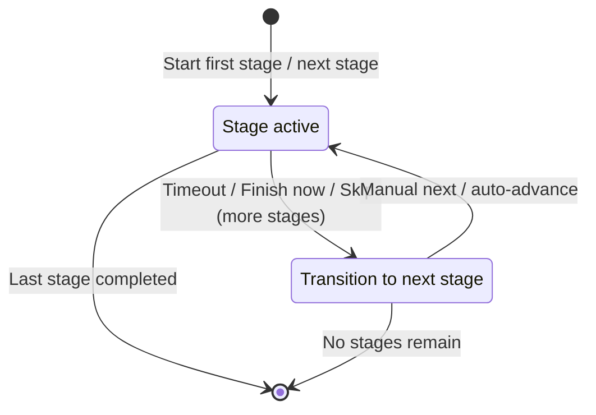

# DigiFlot Edge — execution state machine

Reference date: 2026-11-13. Source of truth: `src/lib/digiflot.py`.
This describes the **global experiment state**, its **stage substate** and the guards
that maintain recording and calibration integrity. The seven labels in the Run
workflow are display substeps, not seven independent runtime states.

## Global experiment machine

```mermaid
stateDiagram-v2
    [*] --> Idle
    Idle --> CellSelection: Select experiment
    CellSelection --> CameraCalibration: Select physical cell
    CameraCalibration --> SensorCalibration: Cameras resolved; sensors pending
    CameraCalibration --> Ready: Cameras and sensors resolved
    SensorCalibration --> CameraCalibration: Reopen camera calibration
    SensorCalibration --> Ready: Finish calibration
    SensorCalibration --> Ready: Cancel untouched recalibration
    Ready --> Ready: Review saved calibration (read-only)
    Ready --> CameraCalibration: Recalibrate camera / camera settings changed
    Ready --> SensorCalibration: Recalibrate sensor / reference or geometry change
    CameraCalibration --> Ready: Cancel untouched recalibration
    Ready --> Running: Verify setup and start Stage 1
    Running --> Paused: Pause
    Paused --> Running: Resume
    Running --> Completed: Last stage completed
    Running --> RecoveryRequired: Acquisition error
    Paused --> RecoveryRequired: Device or process failure
    RecoveryRequired --> Running: Resume / restart / skip stage
    RecoveryRequired --> Aborted: Abort or reset from recovery
    Running --> Aborted: Abort
    Paused --> Aborted: Abort
    Ready --> Aborted: Abort preparation
    CameraCalibration --> Aborted: Abort preparation
    SensorCalibration --> Aborted: Abort preparation
    CellSelection --> Aborted: Abort preparation
    Completed --> Idle: Reset
    Aborted --> Idle: Return to idle / reset
    Error --> Idle: Reset after failure
    Ready --> SensorCalibration: Stale virtual benchmark on restart or Start
    Completed --> CellSelection: Select next experiment
```

- `Aborted` may be transient when the request specifies `return_to_idle=true`. Its event
  and Server state must be persisted **before** the local state becomes `Idle`.
- A process restart while a stage is in progress enters `RecoveryRequired`. A restart
  while preparing restores the preparation state, except an unverified virtual-sensor
  approval is returned to `SensorCalibration`.
- An explicit camera recalibration can start a preview and change exposure. Once hardware
  or configuration changes, the previous approval must not be restored by Cancel.

## Stage machine inside Running

`Paused` is a global state. It retains whether the stage was `Active` or
`Transition` and resumes the corresponding timers. `RecoveryRequired` retains
the interrupted stage and permits resume, restart or skip with an audit trail.

## Transition-node audit

| Current state | Input or operator action | Target state | Code guard |
| --- | --- | --- | --- |
| Idle, Completed, Aborted, Error | Select experiment | CellSelection or restored preparation | `select_experiment`, `_load_existing_runtime_unlocked` |
| CellSelection | Select physical cell/camera | CameraCalibration | `select_physical_cell` |
| CameraCalibration | Confirm or skip cameras | SensorCalibration / Ready | `confirm_camera_calibration`, `skip_camera_calibration`, `_advance_from_camera_calibration_unlocked` |
| Ready | Review sensor | Ready | Read-only `/sensors?review=...`; no reopen request |
| Ready | Recalibrate sensor | SensorCalibration | `reopen_sensor_calibration` |
| Ready | Recalibrate camera | CameraCalibration | `reopen_camera_calibration` |
| Ready | Change physical reference, cell, optics, analysis ROI or ArUco | SensorCalibration | VisionService invalidates the virtual-sensor approval |
| CameraCalibration / SensorCalibration | Cancel an untouched recalibration | Ready | `cancel_calibration_edit`; prior approval restored only if `dirty=false` |
| SensorCalibration | Confirm/skip all applicable sensors | Ready | `complete_sensor_calibration` |
| Ready | Start first stage | Running/Active | Required volume, calibration statuses, fresh virtual benchmark, storage |
| Running/Active | Stage duration, finish or skip | Running/Transition or Completed | `_complete_stage_unlocked` |
| Running/Transition | Start next stage | Running/Active | `start_next_stage` |
| Running | Pause | Paused | `pause` (Active/Transition only) |
| Paused | Resume | Running | `resume`; restores paused timer |
| Running / Paused | Acquisition failure | RecoveryRequired | `_enter_recovery_unlocked` |
| RecoveryRequired | Resume/restart/skip | Running or Completed | `resume_recovery`, `restart_current_stage`, `skip_current_stage` |
| RecoveryRequired | Reset | Aborted then Idle | `reset` calls `abort_experiment` to persist terminal state |
| Any selected preparation or running state | Abort | Aborted / Idle | `abort_experiment` |
| Completed / Aborted / Error | Reset | Idle | `reset` |

## Calibration transaction

**Review** must never change `DigiFlot.state`, a sensor's `status`, or the
saved physical calibration. **Recalibrate** deliberately returns a previously
approved item to `pending`. A copy of that approval is saved in
`calibration_edit` in `runtime.json`. **Cancel** is allowed only before a
recalibration-affecting hardware/configuration action. It returns to Ready and
restores the approval record. After any such action, Cancel must be rejected;
the operator must confirm a valid new calibration or explicitly skip it.
Virtual sensor configuration changes and benchmark attempts mark the transaction
as changed. Reopening alone does not clear a previously valid virtual benchmark.

A cell reference, cell geometry, optical profile, Analysis ROI or ArUco update
can invalidate the Froth Interface signature. If the virtual sensor was approved
and the execution is still in preparation, the workflow must return to
`SensorCalibration`. A deliberately skipped virtual sensor remains skipped.

## Runtime invariants

1. Only one experiment owns the run controller at a time.
2. A new stage cannot start from Ready if camera or sensor calibration is pending.
3. A virtual sensor marked passed needs an approved benchmark that still matches
   the current geometry and detector settings. Restarts cannot silently reuse an
   unavailable in-memory benchmark.
4. A preview must stop before the main camera encoder is started.
5. Vision failure must not stop the video encoder; sensor data and video use
   independent acquisition paths.
6. Active-run edits of camera hardware and physical reference configuration
   are rejected. Acquisition uses frozen experiment snapshots.
7. Physical references use stable ArUco-local centimetres. Selecting a vertical
   datum changes the reported height, not the saved reference coordinates.
8. Reset from RecoveryRequired must persist an Aborted outcome and preserve
   recorded files, not silently discard an unfinished run.
9. Terminal runs remain on disk; selecting another experiment resets the
   controller, not the historical run's immutable data.

## Validation and remaining hardware checks

Hardware-free coverage: `tests/test_vision_workflow_state.py` (state transitions,
rollback, readiness, restart preparation, pause/resume and recovery reset),
`tests/test_workflow_navigation.js` (read-only review and explicit mutation),
existing vision tests and run DOM tests. GitHub Actions runs these checks.

This does not constitute a complete physical Raspberry Pi integration test.
Before production, validate a full experiment with two camera encoders, the
virtual sensor active, Atlas EZO calibration, a pause across stage transitions,
acquisition failure/recovery, and a restart during preparation and during
recording. Measure FPS, timing, thermal load and persisted output integrity.

## Results media isolation (MJPEG)

Results playback is **Idle-only**, even during experiment preparation. FastAPI's
existing HTTP middleware does not guard WebSockets, so
`/api/results/{storage_id}/mjpeg` checks the DigiFlot controller state
separately. A `ResultsMediaManager` is instantiated with the web application,
but never starts a playback thread or FFmpeg process on its own.

- A WebSocket is created only after the user opens an MJPEG recording.
- Each viewer can start one temporary `ffmpeg -c:v copy -f image2pipe` process
  for playback or a one-frame seek. Pausing, navigating away, disconnecting,
  or closing the page stops it; frames only occupy bounded RAM buffers.
- At most two viewers are admitted globally. They have independent playback
  clocks, streams, and teardown. Browser-compatible H.264/WebM still use
  the native `<video>` element; the existing transcoding fallback is also
  rejected outside Idle.
- `DigiFlot.select_experiment()` revokes every media session synchronously
  **before** resetting or preparing the run. Both media process creation
  and experiment selection acquire `digiflot.lock`; media generation tokens
  prevent stale viewers from restarting a worker after revocation.
- A running experiment, calibration, `Ready`, `Paused`, or
  `RecoveryRequired` state refuses new media sessions. No video preview
  files are generated by the MJPEG player. Original recordings stay untouched.

This is not an acquisition path. It must never block camera recording,
sensors, scraping control or the DigiFlot state machine. Test with the real
Raspberry Pi and two simultaneous viewers before production use.

