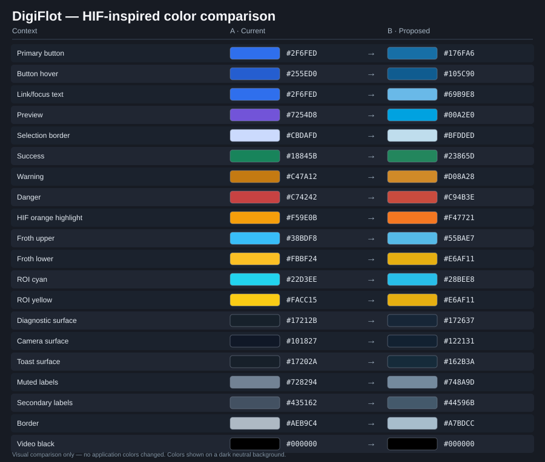

# DigiFlot Edge — HIF-inspired color audit and replacement plan

**Audit baseline:** `main` after Run workflow UI refinements (2026-11-14).  
**Status:** historical before/after audit; the approved mapping was applied on 2026-11-14. The current semantic palette is documented in [COLOR_PALETTE.md](../../COLOR_PALETTE.md).  
**Scope:** every tracked `.css` file (9 files, complete recursive Git tree).

## Brand evidence and design boundary

- The HIF logo uses a **deep blue** wordmark and a **bright orange** accent: [HIF logo uploaded by HZDR](https://commons.wikimedia.org/wiki/File:HIF_logo_GER_subline_below_blue_on_white_RGB.png).
- A published Helmholtz corporate design guide, **version 1.3 (2012)**, specifies Helmholtz blue `#00589C`, dark blue `#003E6E`, grays `#515151`, `#9C9C9C`, `#B9B9B9`, energy yellow `#E6AF11`, and light blue `#00A2E0`: [Helmholtz guide, page 16](https://www.helmholtz.de/fileadmin/user_upload/05_aktuelles/Marke_Design/HG_Corporate_Design_Guidelines_120801.pdf). This is **historical** design guidance, not verified as the 2026 HIF digital UI style guide.
- Proposed `#F47721` is an **approximation of the orange shown in the HIF logo**, not a verified official digital color specification.
- DigiFlot is an operator interface, not a reproduction of HIF corporate stationery. Preserve its dark style and semantics; distinguish **brand**, **interactive control**, **status**, and **measurement plotting**. Do not recolor source images or logo artwork.

## 0. Visual comparison — current color A → proposed color B

This table is the **quick visual map** for the proposed theme. The swatches display the actual HEX colors; the SVG overview is stored in the repository, so there is also an offline-friendly version.

| Context | Color A · current | → | Color B · proposed |
|---|---|:---:|---|
| Primary buttons |  `#2F6FED` | → |  `#176FA6` |
| Button hover |  `#255ED0` | → |  `#105C90` |
| Links and focus on dark panels |  `#2F6FED` | → |  `#69B9E8` |
| Active selection / pale borders |  `#CBDAFD` | → |  `#BFDDED` |
| Live preview (purple → HIF blue) |  `#7254D8` | → |  `#00A2E0` |
| Success / Passed |  `#18845B` | → |  `#23865D` |
| Warning / Skipped |  `#C47A12` | → |  `#D08A28` |
| Danger / Abort |  `#C74242` | → |  `#C94B3E` |
| HIF orange highlights |  `#F59E0B` | → |  `#F47721` |
| Selected physical reference |  `#38BDF8` | → |  `#55BAE7` |
| Froth upper line |  `#0EA5E9` | → |  `#29AEE4` |
| Froth lower line |  `#FBBF24` | → |  `#E6AF11` |
| ROI selection cyan |  `#22D3EE` | → |  `#28BEE8` |
| ROI drag yellow |  `#FACC15` | → |  `#E6AF11` |
| Camera diagnostic surface |  `#17212B` | → |  `#172637` |
| Camera viewport surface |  `#101827` | → |  `#122131` |
| Toast surface |  `#17202A` | → |  `#162B3A` |
| Muted labels |  `#728294` | → |  `#748A9D` |
| Secondary labels |  `#435162` | → |  `#44596B` |
| Neutral borders |  `#AEB9C4` | → |  `#A7BDCC` |
| Video background |  `#000` | → |  `#000` |

**Adaptive neutrals:** `Canvas`, `CanvasText`, neutral surface mixes and shadows should remain theme-aware rather than being replaced with a single HEX. See the semantic foundation below. **Context matters:** a blue used for a solid button should not automatically be used for small text on a dark background.

## 1. Complete file coverage

| CSS file | Approx. lines | Hex occurrences | rgba occurrences | Functional context |
|---|---:|---:|---:|---|
| `src/ui/css/cells.css` | 194 | 13 | 0 | cell geometry, calibrated named references, draggable ROIs and camera planes |
| `src/ui/css/common.css` | 78 | 11 | 0 | global navigation, active-run lock, buttons, operation feedback |
| `src/ui/css/config_camera.css` | 1173 | 44 | 22 | camera form, crop, preview, exposure, errors, notices and hover states |
| `src/ui/css/experiments.css` | 1174 | 19 | 7 | experiment catalog, selected rows, server status, actions and destructive confirmations |
| `src/ui/css/performance.css` | 49 | 3 | 0 | hardware performance/temperature health severity |
| `src/ui/css/results.css` | 572 | 20 | 7 | result tables, playback, plot labels, chart backgrounds and video overlays |
| `src/ui/css/run.css` | 633 | 24 | 3 | workflow, calibration, status, stage timer, sensor cards, Froth and scraping warnings |
| `src/ui/css/sensors.css` | 257 | 32 | 1 | physical sensors, pH/Atlas calibration, Froth ROI and entropy diagnostic graphs |
| `src/ui/css/settings.css` | 157 | 4 | 1 | server configuration and destructive settings |

**Coverage:** 60 distinct hex literals (170 occurrences); 36 distinct `rgb/rgba` expressions (41 occurrences); 26 named CSS color-bearing custom properties. Additionally, `color-mix`, `Canvas`, `CanvasText`, `currentColor`, `transparent`, and CSS gradients must be migrated by semantic token, **not by global text replacement**.

## 2. Proposed semantic foundation

| Role/token | Current implementation | Proposal | Rationale |
|---|---|---|---|
| `--hif-blue` | no direct token | `#00589C` | Helmholtz brand blue from published guide |
| `--hif-dark-blue` | no direct token | `#003E6E` | supporting brand blue |
| `--hif-orange` | no direct token | `#F47721` | logo-derived HIF accent, **approximate** |
| `--hif-light-blue` | no direct token | `#00A2E0` | documented secondary Helmholtz blue |
| `--action-background` | `--accent:#2F6FED` | `light-dark(#00589C,#176FA6)` | maintains white-button-text contrast; dark target is not the logo itself |
| `--action-hover` | `--accent-hover:#255ED0` | `light-dark(#003E6E,#105C90)` | darker interactive step |
| `--interactive-text` | also `--accent` | `light-dark(#00589C,#69B9E8)` | the same button blue is **not** legible as small text on dark cards |
| `--interactive-muted` | accent-soft mix | `color-mix(in srgb,var(--interactive-text) 17%,Canvas)` | keep current restrained selection/background aesthetic |
| `--preview` | `#7254D8` (purple) | `#00A2E0` | separate preview from action without a non-brand purple |
| `--success` | `#18845B` | `#23865D` / dark text `#5FC796` | preserve green as success, not brand blue |
| `--warning` | `#C47A12` | `#D08A28` | warmer, nearer the HIF orange/Helmholtz energy family |
| `--danger` | `#C74242` | `#C94B3E` / dark text `#F28A7C` | preserve distinct danger red |
| `--plot-froth` | `#38BDF8`, `#0EA5E9` | `#55BAE7` | visible on a dark diagnostic canvas |
| `--plot-pulp` | `#F59E0B`, `#FBBF24` | `#F47721`, `#E6AF11` | preserves the physical two-boundary distinction |
| `--bg`, `--surface` | `Canvas` | keep Canvas; optional 2–3% dark-blue tint | minimal disruption to existing dark theme |
| `--surface-soft`, `--border` | `CanvasText`-based `color-mix` | keep mix percentages, use semantic surface tokens | retain current depth and contrast |
| `--text`, `--text-soft`, `--text-faint` | `CanvasText` & alpha mixing | preserve the functional hierarchy, validate contrast | don’t color body text HIF blue |
| `--chart-grid`, `--shadow` | CanvasText + transparency | preserve neutral behavior | no semantic need for saturated colors |

**Contrast rationale:** white on `#176FA6` is roughly 5.4:1; `#00589C` on white is around 7.3:1. Dark-surface text should use the lighter `--interactive-text`, not `--action-background`. All final colors must pass at least WCAG AA where applicable in both color schemes.

## 3. Mapping of every distinct hex literal (all 60)

This is a **proposed mapping**, not an instruction to replace every occurrence blindly: one source color may need different semantic tokens depending on its property and background. The table below includes a representative context for **all 60 original HEX values**. For 8-digit HEX colors, the small swatch displays their RGB hue, and the text retains the exact alpha value.

### Interactive/HIF blues

| Context | Color A · current | → | Color B · proposed |
|---|---|:---:|---|
| Primary accent / controls (12 uses) |  `#2F6FED` | → |  `#176FA6` |
| Interactive hover (6 uses) |  `#255ED0` | → |  `#105C90` |
| Experiment button hover (1 use) |  `#285FCD` | → |  `#0E628E` |
| Active-state border (3 uses) |  `#CBDAFD` | → |  `#BFDDED` |
| Information outline (2 uses) |  `#D8E3FB` | → |  `#C6E4F2` |
| Experiment selection (1 use) |  `#D9E5FF` | → |  `#CBE7F2` |
| Selected reference / Froth (4 uses) |  `#38BDF8` | → |  `#55BAE7` |
| Upper Froth curve (3 uses) |  `#0EA5E9` | → |  `#29AEE4` |
| ROI cyan outline (1 use) |  `#22D3EE` | → |  `#28BEE8` |
| ROI cyan fill (alpha) (1 use) |  `#22D3EE20` | → |  `#28BEE820` |
| Preview outline (1 use) |  `#DDD6FF` | → |  `#B4E1F4` |
| Preview status (10 uses) |  `#7254D8` | → |  `#00A2E0` |

### Warning/energy/HIF orange

| Context | Color A · current | → | Color B · proposed |
|---|---|:---:|---|
| ROI yellow outline (1 use) |  `#FACC15` | → |  `#E6AF11` |
| ROI yellow fill (alpha) (1 use) |  `#FACC1522` | → |  `#E6AF1122` |
| Reference label / pulp (3 uses) |  `#F59E0B` | → |  `#F47721` |
| Lower Froth boundary (2 uses) |  `#FBBF24` | → |  `#E6AF11` |
| Warning outline (2 uses) |  `#EFCE93` | → |  `#E9CBA0` |
| Warning token (13 uses) |  `#C47A12` | → |  `#D08A28` |
| Warning surface (1 use) |  `#F0D8AD` | → |  `#E9CEA8` |
| Warning text (retained) (1 use) |  `#704300` | → |  `#704300` · keep |
| Skipped-calibration border (1 use) |  `#EAD7AE` | → |  `#E4CCA6` |

### Success and danger

| Context | Color A · current | → | Color B · proposed |
|---|---|:---:|---|
| Success token (13 uses) |  `#18845B` | → |  `#23865D` |
| Success outline (8 uses) |  `#CFE5DB` | → |  `#C7E6D7` |
| Danger token (13 uses) |  `#C74242` | → |  `#C94B3E` |
| Danger outline (8 uses) |  `#F3CCCC` | → |  `#EEC7C2` |
| Danger text (1 use) |  `#A51F1F` | → |  `#B73A30` |
| Destructive action (3 uses) |  `#C43D3D` | → |  `#BC493C` |

### Surfaces/text/borders/video

| Context | Color A · current | → | Color B · proposed |
|---|---|:---:|---|
| Secondary label (3 uses) |  `#435162` | → |  `#44596B` |
| Diagnostic background (3 uses) |  `#17212B` | → |  `#172637` |
| Muted text (3 uses) |  `#728294` | → |  `#748A9D` |
| White text (retained) (7 uses) |  `#FFF` | → |  `#FFF` · keep |
| White overlay (retained) (6 uses) |  `#FFFFFF` | → |  `#FFFFFF` · keep |
| Video black (retained) (3 uses) |  `#000` | → |  `#000` · keep |
| Black shadow alpha (retained) (1 use) |  `#0003` | → |  `#0003` · keep |
| Neutral outline (1 use) |  `#CBD4DD` | → |  `#C3D3DF` |
| Cell image border (1 use) |  `#243047` | → |  `#22394D` |
| Cell image background (1 use) |  `#101827` | → |  `#122131` |
| Cell image hint (1 use) |  `#9CAEC8` | → |  `#9DB7CF` |
| ROI shadow alpha (1 use) |  `#0F172A80` | → |  `#0F2B4080` |
| Subtle outline (2 uses) |  `#AEB9C4` | → |  `#A7BDCC` |
| Switch surface (1 use) |  `#D7DEE5` | → |  `#D5E3EC` |
| Switch border (1 use) |  `#BDC8D2` | → |  `#B7CBD6` |
| Input hover border (1 use) |  `#AEBAC6` | → |  `#B3C5D0` |
| Secondary action text (1 use) |  `#3D4C5D` | → |  `#40586B` |
| Camera placeholder text (1 use) |  `#D1DAE3` | → |  `#CCDCE7` |
| Muted camera hint (1 use) |  `#8FA0B0` | → |  `#8FAABA` |
| Information border (1 use) |  `#A9B8C8` | → |  `#AAC3D1` |
| Information background (1 use) |  `#F0F4F7` | → |  `#F0F6FA` |
| Information text (1 use) |  `#607080` | → |  `#607C8E` |
| Light background (1 use) |  `#F7FAFF` | → |  `#F5FAFD` |
| Calibration description (1 use) |  `#657282` | → |  `#607B8D` |
| Preview frame (1 use) |  `#263342` | → |  `#24394A` |
| Preview dark surface (1 use) |  `#111920` | → |  `#122331` |
| Optical viewport (1 use) |  `#05090D` | → |  `#0A161F` |
| Virtual preview surface (1 use) |  `#0D1721` | → |  `#122333` |
| Toast surface (2 uses) |  `#17202A` | → |  `#162B3A` |
| Plot text (light mode) (1 use) |  `#202832` | → |  `#223340` |
| Plot muted (light mode) (1 use) |  `#5E6975` | → |  `#647D8C` |
| Plot text (dark mode) (1 use) |  `#F3F6F8` | → |  `#F2F7FA` |
| Plot muted (dark mode) (1 use) |  `#C6CDD5` | → |  `#C7D8E2` |

## 4. Exact occurrence ledger (every hex in CSS)

Each entry is `file:line · selector / declaration · old -> proposed`. This is a precise cross-file search ledger; **replacements must be applied contextually**.

### `cells.css`

- L72 · `.cell-vision-page .button-primary` / `color`: `#FFF` → `#FFF` (keep)
- L101 · `.cell-vision-page .cv-image-surface` / `border`: `#243047` → `#22394D`
- L102 · `.cell-vision-page .cv-image-surface` / `background`: `#101827` → `#122131`
- L106 · `.cell-vision-page .cv-image-surface:has(img:not([src]))::before` / `color`: `#9CAEC8` → `#9DB7CF`
- L140 · `#roi_drag` / `border`: `#FACC15` → `#E6AF11`
- L140 · `#roi_drag` / `background`: `#FACC1522` → `#E6AF1122`
- L141 · `#roi_selection` / `border`: `#22D3EE` → `#28BEE8`
- L141 · `#roi_selection` / `background`: `#22D3EE20` → `#28BEE820`
- L141 · `#roi_selection` / `box-shadow`: `#0F172A80` → `#0F2B4080`
- L183 · `.cv-named-overlay` / `border-top`: `#FBBF24` → `#E6AF11`
- L184 · `.cv-named-overlay.selected` / `border-color`: `#38BDF8` → `#55BAE7`
- L185 · `.cv-named-overlay > span` / `background`: `#F59E0B` → `#F47721`
- L186 · `.cv-named-overlay.selected > span` / `background`: `#38BDF8` → `#55BAE7`

### `common.css`

- L13 · `:root` / `--accent`: `#2F6FED` → `#176FA6`
- L14 · `:root` / `--accent-hover`: `#255ED0` → `#105C90`
- L15 · `:root` / `--accent-soft`: `#2F6FED` → `#176FA6`
- L16 · `:root` / `--success`: `#18845B` → `#23865D`
- L17 · `:root` / `--success-soft`: `#18845B` → `#23865D`
- L18 · `:root` / `--warning`: `#C47A12` → `#D08A28`
- L19 · `:root` / `--warning-soft`: `#C47A12` → `#D08A28`
- L20 · `:root` / `--danger`: `#C74242` → `#C94B3E`
- L21 · `:root` / `--danger-soft`: `#C74242` → `#C94B3E`
- L49 · `.app-nav-links.execution-locked .run-link` / `color`: `#FFF` → `#FFF` (keep)
- L62 · `.app-operation-feedback` / `box-shadow`: `#0003` → `#0003` (keep)

### `config_camera.css`

- L12 · `:root` / `--accent`: `#2F6FED` → `#176FA6`
- L13 · `:root` / `--accent-hover`: `#255ED0` → `#105C90`
- L14 · `:root` / `--accent-soft`: `#2F6FED` → `#176FA6`
- L15 · `:root` / `--success`: `#18845B` → `#23865D`
- L16 · `:root` / `--success-soft`: `#18845B` → `#23865D`
- L17 · `:root` / `--warning`: `#C47A12` → `#D08A28`
- L18 · `:root` / `--warning-soft`: `#C47A12` → `#D08A28`
- L19 · `:root` / `--danger`: `#C74242` → `#C94B3E`
- L20 · `:root` / `--danger-soft`: `#C74242` → `#C94B3E`
- L21 · `:root` / `--preview`: `#7254D8` → `#00A2E0`
- L22 · `:root` / `--preview-soft`: `#7254D8` → `#00A2E0`
- L142 · `.state-badge.state-idle` / `border-color`: `#CFE5DB` → `#C7E6D7`
- L147 · `.state-badge.state-preview` / `border-color`: `#DDD6FF` → `#B4E1F4`
- L152 · `.state-badge.state-recording` / `border-color`: `#F3CCCC` → `#EEC7C2`
- L318 · `.field > label` / `color`: `#435162` → `#44596B`
- L340 · `.field input:hover:not(:disabled), .field select:hover:not(:disabled)` / `border-color`: `#AEBAC6` → `#B3C5D0`
- L433 · `.switch-field` / `color`: `#435162` → `#44596B`
- L451 · `.switch-field .switch` / `border`: `#BDC8D2` → `#B7CBD6`
- L453 · `.switch-field .switch` / `background`: `#D7DEE5` → `#D5E3EC`
- L567 · `.button.button-primary` / `color`: `#FFFFFF` → `#FFFFFF` (keep)
- L576 · `.button.button-secondary` / `color`: `#3D4C5D` → `#40586B`
- L579 · `.button.button-secondary:hover:not(:disabled)` / `border-color`: `#AEB9C4` → `#A7BDCC`
- L594 · `.button.is-loading::after` / `color`: `#FFFFFF` → `#FFFFFF` (keep)
- L625 · `.preview-stage` / `border`: `#CBD4DD` → `#C3D3DF`
- L627 · `.preview-stage` / `background`: `#263342` → `#24394A`
- L627 · `.preview-stage` / `background`: `#17212B` → `#172637`
- L627 · `.preview-stage` / `background`: `#111920` → `#122331`
- L641 · `.preview-viewport` / `background`: `#05090D` → `#0A161F`
- L679 · `.crop-selection-box` / `border`: `#FFFFFF` → `#FFFFFF` (keep)
- L693 · `.crop-selection-box::before, .crop-selection-box::after` / `border`: `#FFFFFF` → `#FFFFFF` (keep)
- L718 · `.crop-selection-instruction` / `color`: `#FFFFFF` → `#FFFFFF` (keep)
- L743 · `.preview-placeholder` / `color`: `#D1DAE3` → `#CCDCE7`
- L751 · `.preview-placeholder span` / `color`: `#8FA0B0` → `#8FAABA`
- L759 · `.preview-placeholder-icon` / `border`: `#728294` → `#748A9D`
- L770 · `.preview-placeholder-icon::before` / `border`: `#728294` → `#748A9D`
- L781 · `.preview-placeholder-icon::after` / `background`: `#728294` → `#748A9D`
- L813 · `.info-note` / `border-left`: `#A9B8C8` → `#AAC3D1`
- L815 · `.info-note` / `background`: `#F0F4F7` → `#F0F6FA`
- L817 · `.info-note` / `color`: `#607080` → `#607C8E`
- L863 · `.control-field-header label` / `color`: `#435162` → `#44596B`
- L975 · `.unsaved-indicator` / `background`: `#AEB9C4` → `#A7BDCC`
- L1124 · `.calibration-banner` / `border-color`: `#CBDAFD` → `#BFDDED`
- L1124 · `.calibration-banner` / `background`: `#F7FAFF` → `#F5FAFD`
- L1126 · `.calibration-banner p` / `color`: `#657282` → `#607B8D`

### `experiments.css`

- L13 · `@charset "UTF-8"; :root` / `--accent`: `#2F6FED` → `#176FA6`
- L14 · `@charset "UTF-8"; :root` / `--accent-hover`: `#255ED0` → `#105C90`
- L15 · `@charset "UTF-8"; :root` / `--accent-soft`: `#2F6FED` → `#176FA6`
- L16 · `@charset "UTF-8"; :root` / `--success`: `#18845B` → `#23865D`
- L17 · `@charset "UTF-8"; :root` / `--success-soft`: `#18845B` → `#23865D`
- L18 · `@charset "UTF-8"; :root` / `--warning`: `#C47A12` → `#D08A28`
- L19 · `@charset "UTF-8"; :root` / `--warning-soft`: `#C47A12` → `#D08A28`
- L20 · `@charset "UTF-8"; :root` / `--danger`: `#C74242` → `#C94B3E`
- L21 · `@charset "UTF-8"; :root` / `--danger-soft`: `#C74242` → `#C94B3E`
- L22 · `@charset "UTF-8"; :root` / `--preview`: `#7254D8` → `#00A2E0`
- L23 · `@charset "UTF-8"; :root` / `--preview-soft`: `#7254D8` → `#00A2E0`
- L142 · `.state-connected` / `border-color`: `#CFE5DB` → `#C7E6D7`
- L155 · `.state-error` / `border-color`: `#F3CCCC` → `#EEC7C2`
- L245 · `.button-primary` / `color`: `#FFFFFF` → `#FFFFFF` (keep)
- L249 · `.button-primary:hover:not(:disabled)` / `background`: `#285FCD` → `#0E628E`
- L411 · `.experiment-row.selected td` / `border-bottom-color`: `#D9E5FF` → `#CBE7F2`
- L448 · `.experiment-badge, .count-pill` / `border`: `#D8E3FB` → `#C6E4F2`
- L725 · `.detail-error` / `border`: `#F3CCCC` → `#EEC7C2`
- L960 · `.button-danger` / `color`: `#A51F1F` → `#B73A30`

### `performance.css`

- L30 · `.result-pass` / `border-color`: `#18845B` → `#23865D`
- L33 · `.result-marginal` / `border-color`: `#C47A12` → `#D08A28`
- L36 · `.result-fail` / `border-color`: `#C74242` → `#C94B3E`

### `results.css`

- L12 · `:root` / `--accent`: `#2F6FED` → `#176FA6`
- L13 · `:root` / `--accent-hover`: `#255ED0` → `#105C90`
- L14 · `:root` / `--accent-soft`: `#2F6FED` → `#176FA6`
- L15 · `:root` / `--success`: `#18845B` → `#23865D`
- L16 · `:root` / `--success-soft`: `#18845B` → `#23865D`
- L17 · `:root` / `--warning`: `#C47A12` → `#D08A28`
- L18 · `:root` / `--warning-soft`: `#C47A12` → `#D08A28`
- L19 · `:root` / `--danger`: `#C74242` → `#C94B3E`
- L20 · `:root` / `--danger-soft`: `#C74242` → `#C94B3E`
- L21 · `:root` / `--preview`: `#7254D8` → `#00A2E0`
- L22 · `:root` / `--preview-soft`: `#7254D8` → `#00A2E0`
- L27 · `:root` / `--plot-text`: `#202832` → `#223340`
- L28 · `:root` / `--plot-muted`: `#5E6975` → `#647D8C`
- L34 · `@media (prefers-color-scheme: dark) { :root` / `--plot-text`: `#F3F6F8` → `#F2F7FA`
- L35 · `@media (prefers-color-scheme: dark) { :root` / `--plot-muted`: `#C6CDD5` → `#C7D8E2`
- L73 · `.button-primary` / `color`: `#FFF` → `#FFF` (keep)
- L168 · `.video-player` / `background`: `#000` → `#000` (keep)
- L495 · `.video-player-wrap` / `background`: `#000` → `#000` (keep)
- L496 · `.video-player` / `background`: `#000` → `#000` (keep)
- L506 · `.video-loading` / `color`: `#FFF` → `#FFF` (keep)

### `run.css`

- L12 · `:root` / `--accent`: `#2F6FED` → `#176FA6`
- L13 · `:root` / `--accent-hover`: `#255ED0` → `#105C90`
- L14 · `:root` / `--accent-soft`: `#2F6FED` → `#176FA6`
- L15 · `:root` / `--success`: `#18845B` → `#23865D`
- L16 · `:root` / `--success-soft`: `#18845B` → `#23865D`
- L17 · `:root` / `--warning`: `#C47A12` → `#D08A28`
- L18 · `:root` / `--warning-soft`: `#C47A12` → `#D08A28`
- L19 · `:root` / `--danger`: `#C74242` → `#C94B3E`
- L20 · `:root` / `--danger-soft`: `#C74242` → `#C94B3E`
- L21 · `:root` / `--preview`: `#7254D8` → `#00A2E0`
- L22 · `:root` / `--preview-soft`: `#7254D8` → `#00A2E0`
- L54 · `.state-running, .state-ready, .state-completed` / `border-color`: `#CFE5DB` → `#C7E6D7`
- L55 · `.state-paused` / `border-color`: `#F0D8AD` → `#E9CEA8`
- L56 · `.state-error, .state-recoveryrequired` / `border-color`: `#F3CCCC` → `#EEC7C2`
- L62 · `.workflow-step.active span` / `border-color`: `#CBDAFD` → `#BFDDED`
- L64 · `.workflow-step.done span` / `border-color`: `#CFE5DB` → `#C7E6D7`
- L85 · `.button-warning` / `color`: `#704300` → `#704300` (keep)
- L85 · `.button-warning` / `border-color`: `#EFCE93` → `#E9CBA0`
- L98 · `.indicator-on` / `border-color`: `#CFE5DB` → `#C7E6D7`
- L99 · `.indicator-rec` / `border-color`: `#F3CCCC` → `#EEC7C2`
- L105 · `.scraping-box` / `border`: `#EFCE93` → `#E9CBA0`
- L126 · `.toast` / `background`: `#17202A` → `#162B3A`
- L145 · `.connection-state.connected` / `border-color`: `#CFE5DB` → `#C7E6D7`
- L147 · `.connection-state.error` / `border-color`: `#F3CCCC` → `#EEC7C2`

### `sensors.css`

- L12 · `:root` / `--accent`: `#2F6FED` → `#176FA6`
- L13 · `:root` / `--accent-hover`: `#255ED0` → `#105C90`
- L14 · `:root` / `--accent-soft`: `#2F6FED` → `#176FA6`
- L15 · `:root` / `--success`: `#18845B` → `#23865D`
- L16 · `:root` / `--success-soft`: `#18845B` → `#23865D`
- L17 · `:root` / `--warning`: `#C47A12` → `#D08A28`
- L18 · `:root` / `--warning-soft`: `#C47A12` → `#D08A28`
- L19 · `:root` / `--danger`: `#C74242` → `#C94B3E`
- L20 · `:root` / `--danger-soft`: `#C74242` → `#C94B3E`
- L21 · `:root` / `--preview`: `#7254D8` → `#00A2E0`
- L22 · `:root` / `--preview-soft`: `#7254D8` → `#00A2E0`
- L54 · `.state-sensorcalibration, .state-ready, .state-running, .status-connected, .calibration-pill.passed` / `border-color`: `#CFE5DB` → `#C7E6D7`
- L55 · `.calibration-pill.skipped` / `border-color`: `#EAD7AE` → `#E4CCA6`
- L57 · `.status-starting` / `border-color`: `#D8E3FB` → `#C6E4F2`
- L58 · `.status-error, .state-error` / `border-color`: `#F3CCCC` → `#EEC7C2`
- L59 · `.calibration-banner, .calibration-footer` / `border`: `#CBDAFD` → `#BFDDED`
- L82 · `.sensor-message` / `border`: `#F3CCCC` → `#EEC7C2`
- L99 · `.calibration-point.done` / `border-color`: `#CFE5DB` → `#C7E6D7`
- L104 · `.button-primary` / `color`: `#FFF` → `#FFF` (keep)
- L110 · `.toast` / `background`: `#17202A` → `#162B3A`
- L110 · `.toast` / `color`: `#FFF` → `#FFF` (keep)
- L158 · `.virtual-preview img` / `background`: `#0D1721` → `#122333`
- L178 · `.virtual-chart-legend > span::before` / `background`: `#0EA5E9` → `#29AEE4`
- L179 · `.virtual-chart-legend .virtual-legend-pulp::before` / `background`: `#F59E0B` → `#F47721`
- L198 · `.virtual-diagnostic-stage` / `background`: `#17212B` → `#172637`
- L204 · `.virtual-profile-legend i, .virtual-chart-key span::before` / `background`: `#0EA5E9` → `#29AEE4`
- L212 · `.virtual-chart-key .virtual-upper-key::before` / `background`: `#0EA5E9` → `#29AEE4`
- L213 · `.virtual-chart-key .virtual-lower-key::before` / `background`: `#F59E0B` → `#F47721`
- L228 · `.virtual-roi-stage` / `background`: `#17212B` → `#172637`
- L251 · `.virtual-reference-level i` / `background`: `#FBBF24` → `#E6AF11`
- L252 · `.virtual-reference-level.selected` / `border-color`: `#38BDF8` → `#55BAE7`
- L253 · `.virtual-reference-level.selected i` / `background`: `#38BDF8` → `#55BAE7`

### `settings.css`

- L65 · `.button-primary` / `color`: `#FFF` → `#FFF` (keep)
- L67 · `.button-danger` / `border-color`: `#C43D3D` → `#BC493C`
- L67 · `.button-danger` / `color`: `#C43D3D` → `#BC493C`
- L68 · `.button-danger:not(:disabled):hover, .button-danger.restart-required` / `background`: `#C43D3D` → `#BC493C`

## 5. Functional RGB(A) replacements (every occurrence)

Keep transparency alpha unchanged; translate hue only where the semantic role warrants it. Black/white translucent overlays are intentionally preserved.

### `cells.css`

- No rgb/rgba literals.

### `common.css`

- No rgb/rgba literals.

### `config_camera.css`

- L42 · `body` / `background`: `rgba(47, 111, 237, 0.06)` → `rgba(23, 111, 166, 0.06)`
- L139 · `.state-badge .state-dot` / `box-shadow`: `rgba(100, 112, 125, 0.12)` → `rgba(91, 117, 136, 0.12)`
- L345 · `.field input:focus:not(:disabled), .field select:focus:not(:disabled)` / `box-shadow`: `rgba(47, 111, 237, 0.11)` → `rgba(23, 111, 166, 0.11)`
- L465 · `.switch-field .switch::after` / `box-shadow`: `rgba(30, 42, 56, 0.25)` → `rgba(29, 52, 69, 0.25)`
- L568 · `.button.button-primary` / `box-shadow`: `rgba(47, 111, 237, 0.18)` → `rgba(23, 111, 166, 0.18)`
- L642 · `.preview-viewport` / `box-shadow`: `rgba(0, 0, 0, 0.24)` → `rgba(0, 0, 0, 0.24)` (keep)
- L681 · `.crop-selection-box` / `background`: `rgba(47, 111, 237, 0.12)` → `rgba(23, 111, 166, 0.12)`
- L682 · `.crop-selection-box` / `box-shadow`: `rgba(5, 11, 17, 0.48)` → `rgba(8, 20, 30, 0.48)`
- L682 · `.crop-selection-box` / `box-shadow`: `rgba(47, 111, 237, 0.95)` → `rgba(23, 111, 166, 0.95)`
- L682 · `.crop-selection-box` / `box-shadow`: `rgba(0, 0, 0, 0.28)` → `rgba(0, 0, 0, 0.28)` (keep)
- L714 · `.crop-selection-instruction` / `border`: `rgba(255, 255, 255, 0.16)` → `rgba(255, 255, 255, 0.16)` (keep)
- L716 · `.crop-selection-instruction` / `background`: `rgba(10, 16, 22, 0.78)` → `rgba(12, 27, 38, 0.78)`
- L728 · `.crop-selection-instruction span` / `color`: `rgba(255, 255, 255, 0.68)` → `rgba(255, 255, 255, 0.68)` (keep)
- L733 · `.preview-stage.crop-mode` / `border-color`: `rgba(47, 111, 237, 0.7)` → `rgba(23, 111, 166, 0.7)`
- L734 · `.preview-stage.crop-mode` / `box-shadow`: `rgba(47, 111, 237, 0.12)` → `rgba(23, 111, 166, 0.12)`
- L793 · `.preview-overlay span` / `border`: `rgba(255, 255, 255, 0.12)` → `rgba(255, 255, 255, 0.12)` (keep)
- L795 · `.preview-overlay span` / `background`: `rgba(10, 16, 22, 0.68)` → `rgba(12, 27, 38, 0.68)`
- L797 · `.preview-overlay span` / `color`: `rgba(255, 255, 255, 0.84)` → `rgba(255, 255, 255, 0.84)` (keep)
- L894 · `.control-slider-row .control-number:focus` / `box-shadow`: `rgba(47, 111, 237, 0.1)` → `rgba(23, 111, 166, 0.1)`
- L976 · `.unsaved-indicator` / `box-shadow`: `rgba(174, 185, 196, 0.13)` → `rgba(166, 188, 205, 0.13)`
- L980 · `.unsaved-indicator.is-dirty` / `box-shadow`: `rgba(164, 103, 9, 0.12)` → `rgba(207, 111, 33, 0.12)`
- L1135 · `.performance-guard` / `border`: `rgba(127,127,127,.28)` → `rgba(115, 137, 151, .28)`

### `experiments.css`

- L43 · `body` / `background`: `rgba(47, 111, 237, 0.06)` → `rgba(23, 111, 166, 0.06)`
- L138 · `.state-dot` / `box-shadow`: `rgba(100, 112, 125, 0.12)` → `rgba(91, 117, 136, 0.12)`
- L857 · `.experiment-state` / `background`: `rgba(0, 0, 0, 0.06)` → `rgba(0, 0, 0, 0.06)` (keep)
- L959 · `.button-danger` / `border-color`: `rgba(180, 30, 30, 0.35)` → `rgba(185, 65, 55, 0.35)`
- L961 · `.button-danger` / `background`: `rgba(180, 30, 30, 0.06)` → `rgba(185, 65, 55, 0.06)`
- L964 · `.button-danger:hover:not(:disabled)` / `border-color`: `rgba(180, 30, 30, 0.6)` → `rgba(185, 65, 55, 0.6)`
- L965 · `.button-danger:hover:not(:disabled)` / `background`: `rgba(180, 30, 30, 0.12)` → `rgba(185, 65, 55, 0.12)`

### `performance.css`

- No rgb/rgba literals.

### `results.css`

- L29 · `:root` / `--plot-grid`: `rgba(32, 40, 50, .15)` → `rgba(32, 52, 68, .15)`
- L36 · `@media (prefers-color-scheme: dark) { :root` / `--plot-grid`: `rgba(255, 255, 255, .16)` → `rgba(255, 255, 255, .16)` (keep)
- L44 · `body` / `background`: `rgba(47, 111, 237, .06)` → `rgba(23, 111, 166, .06)`
- L208 · `.file-dialog` / `box-shadow`: `rgba(0,0,0,.28)` → `rgba(0, 0, 0, .28)`
- L209 · `.file-dialog::backdrop` / `background`: `rgba(0,0,0,.42)` → `rgba(0, 0, 0, .42)`
- L505 · `.video-loading` / `background`: `rgba(0,0,0,.62)` → `rgba(0, 0, 0, .62)`
- L550 · `.track-tooltip` / `box-shadow`: `rgba(0,0,0,.2)` → `rgba(0, 0, 0, .2)`

### `run.css`

- L35 · `body` / `background`: `rgba(47,111,237,.06)` → `rgba(23, 111, 166, .06)`
- L123 · `.scrape-signal` / `background`: `rgba(196,122,18,.88)` → `rgba(207, 104, 0, .88)`
- L203 · `.recovery-details > div` / `border`: `rgba(127,127,127,.25)` → `rgba(115, 137, 151, .25)`

### `sensors.css`

- L35 · `body` / `background`: `rgba(47,111,237,.06)` → `rgba(23, 111, 166, .06)`

### `settings.css`

- L5 · `body` / `background`: `rgba(47,111,237,.06)` → `rgba(23, 111, 166, .06)`

## 6. Existing CSS variables requiring consolidation

Color values are currently copied into `:root` of multiple pages. Their definitions should be consolidated into a shared semantic design system without removing page-specific styles.

| Existing custom property | Current values or expression | Migration |
|---|---|---|
| `--accent` | `#2f6fed` | split action and text roles |
| `--accent-hover` | `#255ed0` | split action and text roles |
| `--accent-soft` | `color-mix(in srgb, #2f6fed 18%, Canvas)` | split action and text roles |
| `--bg` | `Canvas` | retain/derive from semantic surface, border or text tokens |
| `--border` | `color-mix(in srgb, CanvasText 18%, transparent)` | retain/derive from semantic surface, border or text tokens |
| `--border-strong` | `color-mix(in srgb, CanvasText 28%, transparent)` | retain/derive from semantic surface, border or text tokens |
| `--chart-grid` | `color-mix(in srgb, CanvasText 12%, transparent)` | preserve quiet grid |
| `--danger` | `#c74242` | semantic danger token |
| `--danger-soft` | `color-mix(in srgb, #c74242 16%, Canvas)` | semantic danger token |
| `--plot-grid` | `rgba(32, 40, 50, .15)`, `rgba(255, 255, 255, .16)` | plot-specific color |
| `--plot-muted` | `#5e6975`, `#c6cdd5` | plot-specific color |
| `--plot-text` | `#202832`, `#f3f6f8` | plot-specific color |
| `--preview` | `#7254d8` | use light-blue preview |
| `--preview-soft` | `color-mix(in srgb, #7254d8 18%, Canvas)` | use light-blue preview |
| `--shadow` | `0 14px 42px color-mix(in srgb, CanvasText 8%, transparent)` | preserve neutral shadow |
| `--shadow-soft` | `0 6px 20px color-mix(in srgb, CanvasText 6%, transparent)`, `0 7px 24px color-mix(in srgb, CanvasText 7%, transparent)` | preserve neutral shadow |
| `--success` | `#18845b` | semantic green token |
| `--success-soft` | `color-mix(in srgb, #18845b 16%, Canvas)` | semantic green token |
| `--surface` | `Canvas` | retain/derive from semantic surface, border or text tokens |
| `--surface-soft` | `color-mix(in srgb, CanvasText 5%, Canvas)` | retain/derive from semantic surface, border or text tokens |
| `--surface-strong` | `color-mix(in srgb, CanvasText 9%, Canvas)` | retain/derive from semantic surface, border or text tokens |
| `--text` | `CanvasText` | retain/derive from semantic surface, border or text tokens |
| `--text-faint` | `color-mix(in srgb, CanvasText 50%, transparent)` | retain/derive from semantic surface, border or text tokens |
| `--text-soft` | `color-mix(in srgb, CanvasText 68%, transparent)` | retain/derive from semantic surface, border or text tokens |
| `--warning` | `#c47a12` | semantic amber token |
| `--warning-soft` | `color-mix(in srgb, #c47a12 17%, Canvas)` | semantic amber token |

## 7. Context-by-context migration rules

| Component/context | Action | Caution |
|---|---|---|
| Global navbar & selected routes (`common.css`) | HIF action blue, quieter blue hover/selection | actual logo asset unchanged |
| Experiment catalog (`experiments.css`) | align selected row, primary action, warnings | preserve clear selected vs disabled states |
| Camera calibration (`config_camera.css`) | use HIF blue for buttons/focus, cyan for preview, neutral tinted dark planes | actual camera pixels, calibration crops and overlays retain meaning |
| Cells/ArUco (`cells.css`) | blue/cyan lines and orange physical marker label roles | maintain contrast on dark photographed materials |
| Physical sensors (`sensors.css`) | semantic states and mild focus blue | chart line means actual measurement, not workflow state |
| Froth Interface (`sensors.css`, `run.css`) | retain blue upper line vs warm lower line | maintain distinct identities and legend, ideally non-color line style redundancy |
| Execution Run (`run.css`) | brand blue primary actions; green passed; amber skipped/warning; red abort | never color skipped green or danger blue |
| Scraping alert (`run.css`) | use orange `#CF6800` overlay, paired with white/high-contrast text | operator warning must remain conspicuous |
| Performance (`performance.css`) | keep severity thresholds; recolor only severity presentation | never change safe/unsafe semantics |
| Results/charts/video (`results.css`) | transparent plotting grid, surface neutrals, readable labels | retain black video player background; don't recolor media |
| Settings (`settings.css`) | align focus/primary and dangerous actions | danger button must remain visibly distinct |

## 8. Suggested migration order

1. Define shared `--hif-*`, `--action-*`, `--interactive-*`, `--status-*`, and `--plot-*` in one shared stylesheet. Do not remove legacy aliases in the first patch.
2. Migrate backgrounds/text/borders for all nine CSS files, preserving `Canvas` and `CanvasText` mode support.
3. Separate solid button color from link/focus color (critical for contrast), then migrate preview and diagnostic plot colors.
4. Replace remaining hard-coded hex and RGB(A) **by component role** using the ledgers above; treat overlaid camera/calibration colors as visualization data.
5. Validate at 14-inch layout and at narrow breakpoints, light and dark; run WCAG contrast checks, regression CI and physical sensor visualization smoke tests.
6. Audit CSS-adjacent JS canvas colors, image overlays and SVG attributes separately before declaring the entire UI palette standardized. This inventory only claims `.css` coverage.

**Historical note:** this document records the pre-migration palette and the original plan. The new palette is implemented in the CSS and is documented in [COLOR_PALETTE.md](../../COLOR_PALETTE.md).
